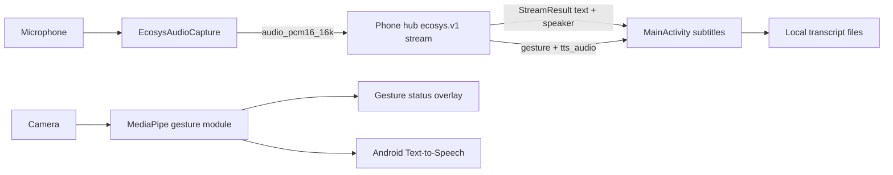

<div align="center">

# 字幕眼鏡 Android Demo

即時語音轉文字、語者分離、字幕顯示與手勢辨識的 Android 原型。


[Overview](#overview) · [Features](#features) · [Quick start](#quick-start) · [Architecture](#architecture) · [Troubleshooting](#troubleshooting)

</div>

---

## Overview

This project is an Android demo for a smart-glasses-style subtitle workflow. On
start-up the user picks a role — 聽障 (deaf) or 健全 (hearing). The app then opens
a plaintext `ecosys.v1` gRPC stream to the phone hub (no pairing, no bearer token)
and exchanges media on it:

- **聽障 (deaf)** captures 16 kHz mono PCM16 microphone audio and streams it to the
  hub, which runs speech-to-text and speaker diarization on-device and returns
  subtitles tagged with a speaker label/colour.
- **健全 (hearing)** receives hub-recognised gesture text and hub-synthesized audio
  from the phone pointed at whoever is signing.

The app also integrates a separate MediaPipe gesture-recognition module for local
gesture detection, and a voiceprint-enrollment screen that records 8 seconds of
audio and registers a name on the hub.

## Features

| Feature                 | What it does                                                          | Main files                                                     |
| ----------------------- | --------------------------------------------------------------------- | -------------------------------------------------------------- |
| Role chooser            | Picks the deaf/hearing session that gates payload kind and display    | `RoleChooserActivity.java`, `ecosys/SessionMode.java`          |
| ecosys stream client    | Opens the hub's `StreamService/OpenStream` bidi stream, no token      | `ecosys/EcosysStreamClient.java`                               |
| Subtitle display        | Renders hub transcripts with per-speaker colour separation            | `MainActivity.java`, `ecosys/SpeakerColourMap.java`            |
| Mic audio uplink        | Streams 16 kHz PCM16 audio frames to the hub (聽障 mode)              | `ecosys/EcosysAudioCapture.java`, `ecosys/AudioFraming.java`   |
| Gesture display + audio | Shows hub gesture text and plays hub-synthesized PCM16 (健全 mode)    | `MainActivity.java`, `ecosys/PcmPlayer.java`                   |
| Voiceprint enrollment   | Records 8 s, validates the name, sends an `enroll_request` to the hub | `SpeakerEnrollmentActivity.java`, `ecosys/EnrollmentName.java` |
| Gesture recognition     | Runs MediaPipe gesture recognition from the `:gesture` module         | `gesture/src/main/java/.../GestureBackgroundRunner.kt`         |
| Transcript management   | Saves, lists, renames, deletes and reloads transcript text files      | `TranscriptManager.java`, `SettingsActivity.java`              |
| Settings screen         | Adjusts font size, TTS engine, speaker list and transcript management | `SettingsActivity.java`                                        |

## Architecture



The hub is the phone-side server of the `ecosys.v1` ecosystem; the wire contract
is frozen and published by the hub as
`com.glassstorm.phonemanager:contract`. This app consumes that artifact (from
Maven local) rather than vendoring the generated bindings.

## Tech stack

| Area                | Technology                                       |
| ------------------- | ------------------------------------------------ |
| App platform        | Android app module `:app`                        |
| Gesture module      | Android library module `:gesture`                |
| Languages           | Java 11, Kotlin 2.1.0                            |
| Build system        | Gradle, Android Gradle Plugin 8.13.0             |
| Transport           | gRPC + protobuf-lite (`ecosys.v1` contract)      |
| JSON parsing        | Gson 2.10.1                                      |
| UI                  | AppCompat, Material Components, ConstraintLayout |
| Camera and gestures | CameraX 1.4.2, MediaPipe Tasks Vision 0.10.29    |

## Project structure

```text
.
├── app/                         # Main Android app
│   └── src/main/
│       ├── java/hk/edu/hkmu/speakerdiarazationdemo/
│       │   └── ecosys/          # ecosys.v1 stream client, framing, playback
│       └── res/raw/
│           └── config_default.json  # Tracked defaults (display language)
├── gesture/                     # MediaPipe gesture-recognition library module
│   └── src/main/assets/
│       └── gesture_recognizer.task
├── gradle/libs.versions.toml    # Version catalog
├── settings.gradle.kts          # Includes :app and :gesture
└── inmoair3.png                 # README image
```

## Requirements

- Android Studio with Android Gradle Plugin 8.13.0 support
- JDK 17 (required to run Gradle/AGP 8.x; the app compiles to Java 11 bytecode)
- Android SDK:
  - `compileSdk = 36`
  - `minSdk = 28`
  - `targetSdk = 28`
- A reachable phone hub on the same local network (the SoftAP gateway, typically
  `192.168.43.1:50051`)
- The hub's `ecosys.v1` contract in Maven local (`:contract:publishToMavenLocal`
  in the hub repo)
- Android device or emulator with microphone permission
- Camera permission and camera hardware for gesture mode

## Configuration

`app/src/main/res/raw/config_default.json` ships only the default display
language:

```json
{
  "language": "yue"
}
```

There is no API key or server region to configure: the hub owns speech-to-text
and diarization, and every setting is local. Speaker names, font size, and the
TTS engine are adjusted in the in-app Settings screen
(**設定** → 字體大小 / TTS 引擎 / 聲紋註冊).

## Quick start

1. Open this repository in Android Studio.
2. Run Gradle Sync.
3. Build and install the app from Android Studio, or run:

```powershell
.\gradlew.bat :app:assembleDebug
```

On macOS or Linux:

```bash
./gradlew :app:assembleDebug
```

4. Enable the phone's hotspot, join the glasses to it, and make sure the hub is
   serving on the gateway. On first launch, pick a role and grant microphone
   permission. Grant camera permission only if you want local gesture recognition.

## Common commands

| Task                   | Windows command                      |
| ---------------------- | ------------------------------------ |
| Build debug APK        | `.\gradlew.bat :app:assembleDebug`   |
| Run unit tests         | `.\gradlew.bat test`                 |
| Run lint               | `.\gradlew.bat lint`                 |
| Run Gradle checks      | `.\gradlew.bat check`                |
| Run instrumented tests | `.\gradlew.bat connectedAndroidTest` |

`connectedAndroidTest` requires a connected Android device or running emulator.

## Usage notes

- The role chooser decides what the session does: 聽障 sends audio and shows
  subtitles; 健全 shows gesture text and plays hub audio.
- The main screen displays live subtitles transcribed by the hub.
- The settings screen controls font size, TTS engine, speaker setup and transcript
  management.
- Speaker enrollment records 8 seconds locally and registers the voiceprint on the
  hub over the same stream.
- Saved transcripts are stored in the app-private files directory.
- Gesture recognition uses `gesture/src/main/assets/gesture_recognizer.task`.

## Troubleshooting

| Problem                            | Check                                                                         |
| ---------------------------------- | ----------------------------------------------------------------------------- |
| App shows no subtitles             | Confirm the hub is reachable at the SoftAP gateway and the stream is open.    |
| Cannot connect to the hub          | Join the phone hotspot and confirm the hub is serving on `gateway:50051`.     |
| No microphone input                | Grant microphone permission and test on a device with microphone hardware.    |
| Gesture recognition does not start | Grant camera permission and confirm the device has an available camera.       |
| TTS does not speak                 | Check Android Text-to-Speech settings and installed voice data.               |
| Build cannot find SDK              | Open Android Studio SDK Manager and install API 36 plus required build tools. |

## Security and privacy notes

- Microphone audio is streamed over the local hotspot to the phone hub only; no
  cloud service is contacted.
- Enrollment audio and transcripts are handled locally by the app; the hub owns
  the voiceprints.
- Cleartext traffic is enabled because the v1 LAN stream is plaintext (there is no
  bearer token or pairing step); backup rules exclude voice samples, transcripts,
  and speaker data.

## CI/CD

Two GitHub Actions workflows run automatically:

| Workflow  | Trigger             | What it does                                                                              |
| --------- | ------------------- | ----------------------------------------------------------------------------------------- |
| `CI`      | push to `main`, PRs | Builds the debug APK, runs lint, uploads the APK as a workflow artifact                   |
| `Release` | pushing a tag `v*`  | Builds a signed release APK and attaches it to a GitHub Release with auto-generated notes |

### Releasing

```bash
git tag v1.0.1
git push origin v1.0.1
```

The release workflow builds `assembleRelease` with the version injected from the tag (`v1.0.1` -> `versionName 1.0.1`), verifies the APK signature, and publishes the release.

### Signing setup (one-time)

The release keystore is committed at `app/release.keystore`, but it is **password-protected** and the password never touches Git:

1. Generate the keystore and a strong passphrase locally:

```bash
# Generate a 512-bit random passphrase (paste it into the secret below, do not commit it)
openssl rand -base64 64 | tr -d '\n'

# Generate the keystore (answer the prompts; keep a copy of the keystore + passphrase offline)
keytool -genkeypair -v -keystore app/release.keystore \
  -alias speakerdemo -keyalg RSA -keysize 2048 -validity 10000
```

2. Store the credentials as GitHub Actions secrets (Settings -> Secrets and variables -> Actions):

| Secret              | Value                                       |
| ------------------- | ------------------------------------------- |
| `KEYSTORE_PASSWORD` | the generated passphrase                    |
| `KEY_ALIAS`         | `speakerdemo` (or whatever alias you chose) |

3. Commit the password-protected keystore:

```bash
git add app/release.keystore
git commit -m "Add project release keystore"
```

## Gesture model

The checked-in MediaPipe gesture model lives here:

```text
gesture/src/main/assets/gesture_recognizer.task
```

To replace it, copy the new `.task` model to that path and rebuild the app.
